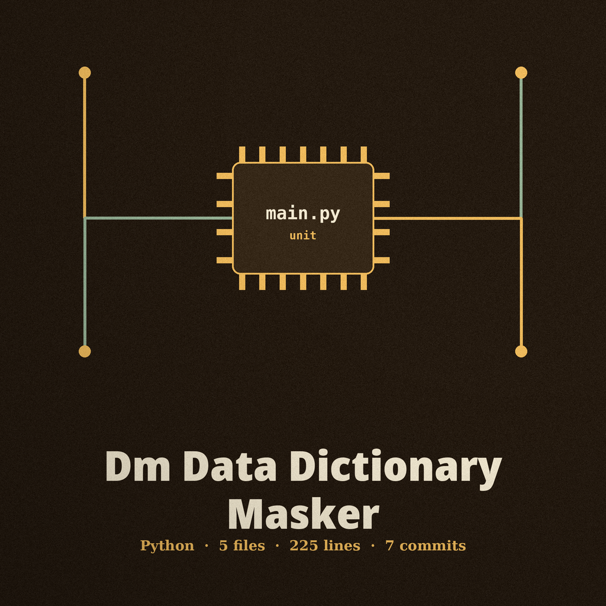
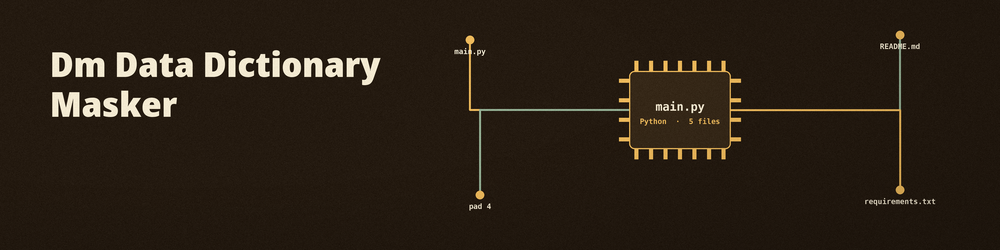

# dm-data-dictionary-masker

Title block: the name above is set in Cinzel in iron gall, in chronicle entry form, with the strigil worked in as a small seal beside the heading and as chapter punctuation from first to last.

# dm-data-dictionary-masker
Masks data based on a user-provided dictionary, replacing specific values with corresponding masked values defined in the dictionary file. - Focused on Tools designed to generate or mask sensitive data with realistic-looking but meaningless values

## Install
`git clone https://github.com/ShadowGuard-AI/dm-data-dictionary-masker`

## Usage
`python3 main.py input_file dictionary_file output_file [options]`

Naming the output file as the input file is refused at exit 1 before any write, including alias and symlink spellings of the same path. When no value matches the dictionary, the run prints `No values matched the dictionary.`, exits 1, and writes no output file.

> Bench tablet: outgoing never equals incoming, under any spelling. The refusal lands at exit 1 before any write, and plain, alias and symlink spellings are all caught.

> Bench tablet: no match means exit 1 and no file. When no value matches the dictionary, no output file comes into existence at all.

## Parameters
- `-h`: Show help message and exit
- `--input_format`: Format of the input file (default: json)
- `--output_format`: Format of the output file (default: json)

> Bench tablet: the dial list is brief, and its brevity is the record. Print names no dial for the incoming file, no dial for the outgoing file, and no dial for the dictionary file, although the mechanism and the usage note both rest on those files. No dial name is invented here to fill that hole.

## License
This project is released under the MIT License. See the [LICENSE](LICENSE) file for details.

## Bench tablets gathered at the strigil hour

The buttons of this re-skin read Mask by the List and Show the Bench Record. Its headings read Only What the List Says, Output Is Never Input, No Match, No File, and Two Formats, Both json by Default, with the word json set in Bitter rather than Cinzel so a format name reads as data instead of display lettering. The hour closes on the bench emptied again: the strigil resting, the catalogued swaps done, and the list itself handed onward.
